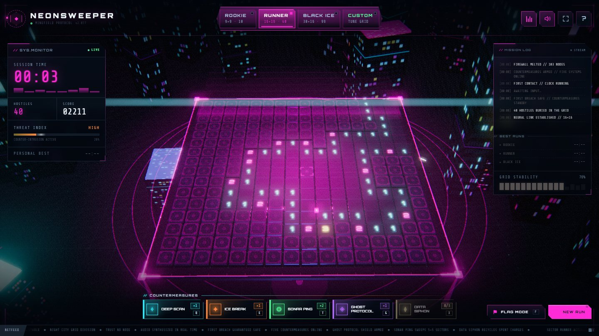

# NEONSWEEPER // MINEFIELD PROTOCOL

[**▶ PLAY IT LIVE — neonsweeper.vercel.app**](https://neonsweeper.vercel.app/)

A cyberpunk 3D Minesweeper built with **three.js**, **anime.js** and the **Web Audio API**. No framework, no build step, and no external runtime assets — every library, font, texture and sound is local or synthesized in the browser.



## Run it

1. Install [Node.js](https://nodejs.org/) 20 or newer.
2. Double-click **`start.bat`** (Windows) or run:

   ```bash
   npm start
   ```

3. The game opens at **<http://localhost:5173>**.

That's it — **no `npm install` is required to play**. three.js, anime.js and all fonts are vendored in `vendor/` and `fonts/`. A local server is needed because browsers block ES module imports over `file://`; the bundled zero-dependency server serves the folder on `127.0.0.1` only.

| Command | What it does |
| --- | --- |
| `npm start` | Start the game server and open the browser |
| `npm start -- --no-open` | Start without opening a browser |
| `node tools/serve.js --no-open` | Same, without npm |
| `$env:PORT=5174; npm start` | Use a different port (PowerShell) |

**Static hosting:** the game has no server-side code. Host the repository root on GitHub Pages, Netlify, Cloudflare Pages or Vercel and it runs as-is. `tools/serve.js` is a local-only convenience; it deliberately lives outside the repository root so Vercel's zero-config Node backend detection cannot mistake it for the app server. The included `vercel.json` pins Vercel to a static deployment with no build step.

## Gameplay

The grid hides hostile ICE nodes. Reveal every safe node to clear the sector.

- The **first breach is always safe** and clears a small pocket around it; the trace clock starts on your first reveal.
- A number counts the hostiles in its eight neighboring nodes.
- Flagging is optional bookkeeping. **Chording** a satisfied number (flag count matches the number) opens all remaining neighbors at once — and can end a run very quickly if the flags are wrong.
- A win records the fastest time per preset/custom configuration. Personal bests, audio settings and the best-runs list persist in `localStorage`.
- Score rewards revealed nodes, decryption progress, full clears and higher hostile density.

### Sector presets

| Sector | Grid | Hostiles | Threat |
| --- | --- | --- | --- |
| **ROOKIE** | 9 × 9 | 10 | LOW |
| **RUNNER** | 16 × 16 | 40 | MID |
| **BLACK ICE** | 30 × 16 | 99 | HIGH |
| **CUSTOM** | 6–30 × 6–20 | 5 to 35% density | YOU |

### Countermeasures

- **Deep Scan (Q, ×1)** — decrypts a guaranteed-safe hidden node.
- **Ice Break (E, ×1)** — instantly flags one hostile.
- **Sonar Ping (T, ×2)** — arms a targeting sweep; the next node click reports the hostile count in its 5×5 sector without revealing a tile.
- **Ghost Protocol (G, ×1)** — passive shield, armed at the first breach. Absorbs one hostile click and tags the mine instead of ending the run.
- **Data Siphon (X)** — banks one salvage token per three correct manual flags. Spend three tokens to refund one spent charge (two refunds per run).
- All systems unlock after the first breach. Deep Scan, Ice Break and Sonar charges are spent for the run unless Data Siphon restores them.

## Controls

| Input | Action |
| --- | --- |
| **Left click** | Reveal a node; click a revealed number to chord it |
| **Right click / Shift + Left click** | Flag or unflag a node |
| **Middle click** | Chord a satisfied number |
| **Drag / scroll** | Orbit / zoom the board |
| **F** | Toggle flag mode (left click / tap flags) |
| **Q / E** | Deep Scan / Ice Break |
| **T / G** | Arm Sonar Ping / inspect Ghost shield |
| **X** | Data Siphon — spend salvage tokens for a charge refund |
| **R / N** | New run |
| **1 / 2 / 3** | Switch to ROOKIE / RUNNER / BLACK ICE |
| **M / S** | Mute soundtrack / SFX |
| **H** | Open the field manual |
| **Esc** | Close a modal or report |
| **Touch** | Tap to reveal, long-press (~0.4 s) to flag |

The top-right buttons add fullscreen and direct audio toggles. The field manual also has soundtrack and SFX volume sliders.

## Features

- **3D instanced board** with per-tile overlays, pylon frame, depth fog, reflective floor and animated markers/mines.
- **Over-the-top presentation** — custom bloom + cyber-grade post shader, glitch effects, impact flashes, particles, scan pulses, shockwaves, floating city skyline, scanlines, grain, vignettes and a boot sequence.
- **Procedural soundtrack and SFX** — punchy synthwave bass/arp/drums plus UI, flag, reveal, scan, defuse, win and loss sounds, all generated live with WebAudio. No audio files.
- **Mission HUD** — sector time, remaining hostiles, score, threat index, grid stability, personal best and a live mission log.
- **Run reports and bests** — animated end screens for wins and losses, automatic mine flagging on victory, and persistent records by difficulty/custom layout.
- **Responsive layout** — side panels fold into a compact mobile readout and touch action bar; reduced-motion preferences are respected; music pauses when the tab is hidden.
- **Fully self-contained** — works offline after the page loads. The only network requests are to the local server.
- **Private by default** — no accounts, API keys, analytics or external services. Progress and settings stay in `localStorage`.

## Project layout

```text
.
├── index.html          # DOM, overlays, modals, import map
├── favicon.svg         # game logo source
├── favicon.ico         # multi-size browser icon
├── apple-touch-icon.png
├── start.bat           # Windows launcher
├── package.json        # scripts and the Playwright dev dependency
├── package-lock.json
├── css/
│   ├── style.css       # imports the four modules below
│   ├── base.css        # theme, atmosphere, layout primitives
│   ├── hud.css         # HUD, top deck, panels, footer, ticker
│   ├── screens.css     # boot, end reports, modals, fatal screens
│   └── responsive.css  # breakpoints and reduced motion
├── js/
│   ├── main.js         # app controller, input, flow, settings
│   ├── game.js         # pure Minesweeper logic
│   ├── scene.js        # three.js scene, board, effects
│   ├── ui.js           # anime.js UI controller
│   ├── audio.js        # WebAudio soundtrack and SFX
│   ├── textures.js     # procedural canvas textures
│   └── config.js       # presets, helpers, stats persistence
├── vendor/             # three.js r180 + anime.js 3.2.2 (MIT)
├── fonts/              # local woff2 fonts + OFL licenses
├── docs/
│   ├── hero.jpg        # README screenshot
│   └── logo.png        # 512px logo for the Vercel avatar
├── tools/              # local server plus logic, verification and UI suites
├── .github/workflows/  # GitHub Actions logic-test workflow
├── .editorconfig       # whitespace and encoding defaults
├── .gitattributes      # line endings and binary assets
├── .gitignore
├── .nojekyll           # keep GitHub Pages from running Jekyll
├── .vercelignore       # dev-only files excluded from deployments
├── vercel.json         # static Vercel deployment, no build step
├── LICENSE
├── SECURITY.md         # vulnerability-reporting policy
└── README.md
```

The dev server serves files with `no-store` caching, so reloading after a code change is enough.

## Tweaking

- **Difficulty presets and custom limits** — `js/config.js`.
- **Colors, glows and type** — CSS custom properties at the top of `css/base.css`.
- **Board geometry, camera, bloom and effects** — `js/scene.js`.
- **Music tempo, mix and synth voices** — `js/audio.js`.
- **Copy and flavor lines** — `js/config.js` and the markup in `index.html`.

## Optional dev checks

The game itself has no npm dependencies. The automated checks use Playwright with your installed Chrome.

```bash
npm install                 # installs Playwright only
npm start -- --no-open      # in one terminal

npm test                    # pure game-logic fuzz/assertion suite
npm run verify              # keyboard, audio, persistence, mobile long-press
npm run test:ui             # full UI walkthrough + screenshots in shots/
npm run test:visual         # responsive collision checks + README hero capture
```

`npm test` needs no browser. `npm run verify`, `npm run test:ui` and `npm run test:visual` expect the local server at <http://localhost:5173> and Chrome installed.

## Third-party assets

- **three.js r180** — MIT, license in `vendor/three/LICENSE`.
- **anime.js 3.2.2** — MIT, license in `vendor/anime/LICENSE.md`.
- **Orbitron, Rajdhani, Share Tech Mono** — SIL Open Font License 1.1, licenses in `fonts/OFL-*.txt`.

All other geometry, textures, effects and audio are generated in code.

## License

MIT — see [LICENSE](LICENSE).
